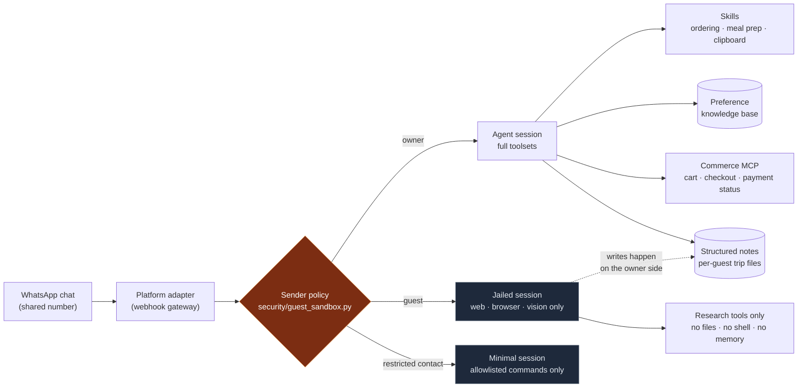

# 🏠 Household Management Agent

**A WhatsApp-first household agent** — one shared chat that runs grocery commerce with real checkout discipline, meal planning with hard dietary rules, and a guest research clipboard. Equal parts *capability* and *containment*: every inbound message is treated as untrusted input.

Household ops already live in chat. This repo is a working design for moving them to an agent — and the security model you need the moment a chat number is shared with people outside the household.

---

## ✨ What it does

| Capability | Skill | The interesting part |
|---|---|---|
| 🛒 **Grocery & food commerce** | [`skills/swiggy-ordering`](skills/swiggy-ordering/SKILL.md) | Brand-precedence resolution, free-delivery-threshold optimization, and a battle-tested UPI **"Duplicate Payment Processing Order"** recovery procedure |
| 🍳 **Meal planning** | [`skills/home-meal-prep`](skills/home-meal-prep/SKILL.md) | A dietary *rules engine*: hard constraints, per-person variants, and a hidden-non-veg detector (oyster sauce, fish sauce, stock powder, gelatin) |
| 🔖 **Guest research clipboard** | [`skills/guest-link-clipboard`](skills/guest-link-clipboard/SKILL.md) | Friends drop travel links in the chat; the agent researches each property and files structured notes — without ever exposing owner data |
| 🔒 **Guest sandbox** | [`security/`](security/guest_sandbox.py) | A toolset jail **enforced in code, not in prompts** — guests cannot talk their way out of it |
| 🗂️ **Preference knowledge base** | [`knowledge-base/`](knowledge-base/example-household.yaml) | Preferences as versioned data with precedence rules, not scattered through prompts |

## 🏗️ Architecture



Full component walkthrough: [`docs/ARCHITECTURE.md`](docs/ARCHITECTURE.md) · Threat model: [`docs/SECURITY.md`](docs/SECURITY.md)

## 🔐 The design bet: trust boundaries in code

The moment a chat number is shared with friends, the agent has **untrusted input driving a privileged system** (it can spend money, read notes, run commands). Prompt-level guardrails ("don't reveal the owner's files") are suggestions; a jailbreak in a guest message can override them.

So the sandbox here is a **code-level toolset gate** resolved per sender before the model ever sees the message:

```python
policy = GuestSandboxPolicy.from_env()

policy.toolsets_for_sender(owner_id)        # None → full platform toolsets
policy.toolsets_for_sender(guest_id)        # ['web', 'browser', 'vision']
policy.toolsets_for_sender(restricted_id)   # ['personal_note']

policy.private_message_allowed(restricted_id, "/memory", profile="isolated")  # False
policy.private_message_allowed(restricted_id, "/help",   profile="isolated")  # True
```

A guest gets a session that *cannot* call the shell, file tools, memory, or commerce — regardless of what the message says. Guests can still be genuinely useful (research, links, lookups), which is the point: **capability without privilege**.

Run the proof:

```bash
python3 security/test_guest_sandbox.py
```

## 🗂️ Knowledge base: preferences as data

Household preferences ("the toddler's milk is never substituted", "an explicitly named product always wins", "prefer brand tier X over cheaper look-alikes") are encoded as **versioned data with precedence rules**, so the same rules drive ordering, meal planning, and shopping lists consistently — see [`knowledge-base/example-household.yaml`](knowledge-base/example-household.yaml) (synthetic example) and the [`schema`](knowledge-base/schema.md).

## 📁 Repo layout

```
household-management-agent/
├── README.md
├── docs/
│   ├── ARCHITECTURE.md          # components & message flow
│   └── SECURITY.md              # threat model for a shared agent
├── security/
│   ├── guest_sandbox.py         # code-enforced toolset jail (standalone)
│   └── test_guest_sandbox.py    # runnable proof of the trust boundary
├── skills/                      # the agent's procedural memory
│   ├── swiggy-ordering/         # commerce: selection, fees, payment recovery
│   ├── home-meal-prep/          # dietary rules engine
│   └── guest-link-clipboard/    # untrusted-input intake workflow
├── knowledge-base/
│   ├── schema.md                # preference schema & precedence rules
│   └── example-household.yaml   # synthetic example data
└── config/
    ├── env.example              # channel + policy wiring (placeholders)
    └── agent-config.example.yaml
```

## 🚀 Quickstart

```bash
git clone https://github.com/aravind-vas/household-management-agent.git
cd household-management-agent

# 1. Verify the trust boundary (stdlib only, no deps)
python3 security/test_guest_sandbox.py

# 2. Load the skills into your agent (Hermes, or any agent with a skills/ prompt layer)
cp -r skills/* /path/to/your/agent/skills/

# 3. Wire your own channel + commerce tools — see config/env.example
```

The commerce integration targets Swiggy (India) via its MCP tool surface (cart, checkout, payment status); the skill documents the workflow generically enough to adapt to any cart/checkout API pair.

## 🗺️ Roadmap

- **v0.2** — voice-note intake from the shared chat (hands-full cooking / driving), calendar-aware meal planning
- **v0.3** — proactive nudges: staples running low, free-delivery threshold suggestions before checkout
- **v0.4** — multi-channel parity (Telegram/Slack) behind the same sender-policy gate

## 🕶️ Privacy note

This repo ships **synthetic example data only**: placeholder sender IDs, example personas, fictional brands. The policy code reads real identifiers from environment variables at runtime and stores none of them.

## License

[MIT](LICENSE)
